# ԳԼՈՒԽ 1. ԳՐԱՖՆԵՐ: ՀԻՄՆԱԿԱՆ ՍԱՀՄԱՆՈՒՄՆԵՐ ԵՎ ՀԱՏԿՈՒԹՅՈՒՆՆԵՐ

## 1.1 Գրաֆի սահմանումը, տեսակները և ներկայացման եղանակները

Գրաֆների տեսությունը դիսկրետ մաթեմատիկայի արդիական և արագ զարգացող ճյուղերից է, որն ուսումնասիրում է օբյեկտների և դրանց միջև առկա կապերի մոդելավորման ու վերլուծության եղանակները: Բարդ համակարգերի կառուցվածքային փոխհարաբերությունները նկարագրելու համար գրաֆների տեսությունն առաջարկում է ունիվերսալ մաթեմատիկական մեթոդ, որտեղ ուսումնասիրվող օբյեկտները ներկայացվում են գագաթների, իսկ դրանց միջև հարաբերությունները՝ կողերի միջոցով:

**Սահմանում 1.1.1։** Գրաֆ կոչվում է $G = (V,\ E)$ կարգավոր զույգը, որտեղ V-ն ոչ դատարկ վերջավոր բազմություն է, իսկ E-ն V բազմության տարրերի երկուական տարր պարունակող ենթաբազմությունների (ոչ կարգավոր զույգերի) բազմությունն է: V բազմության տարրերն անվանում են G գրաֆի գագաթներ, իսկ E բազմության տարրերը՝ կողեր: Գրաֆի գագաթների և կողերի բազմությունները համապատասխանաբար նշանակվում են V(G) և E(G) սիմվոլներով:

**Սահմանում 1.1.2:** V(G) բազմության տարրերի քանակը՝ $n = |V(G)|$-ն, կոչվում է G գրաֆի կարգ , իսկ կողերի քանակը՝ $m = |E(G)|$-ն՝ գրաֆի չափ:

**Սահմանում 1.1.3:** Եթե $e = \{ u,v\} \in E(G)$ (կամ համառոտ՝ $e = uv$), ապա u և v գագաթները կոչվում են հարևան գագաթներ, իսկ e կողը միացնում է u և v գագաթները: Այն դեպքում, երբ $v \in V(G)$ գագաթը պատկանում $e \in E(G)\ $ կողին ($v \in e$), ասում են, որ v գագաթը և e կողը կից են:

Երկրաչափորեն գրաֆը ներկայացվում է հարթության վրա, որտեղ գագաթները պատկերվում են կետերով, իսկ կողերը՝ այդ կետերը միացնող անընդհատ կորերով:

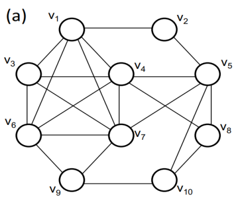

Նկար 1. Տասը գագաթ ունեցող գրաֆ

Կախված կողերի բնույթից, դրանց ուղղվածությունից և կրկնվելու հատկությունից՝ դիտարկվում են գրաֆների հետևյալ հիմնական տեսակները.

**Սահմանում 1.1.4:** Պարզ գրաֆ է կոչվում այն չկողմնորոշված գրաֆը, որը չի պարունակում օղակներ (կող, որի ծայրակետերը համընկնում են) և կրկնակի (զուգահեռ) կողեր:

**Սահմանում 1.1.5 :** Եթե գրաֆում թույլատրվում է նույն զույգ գագաթների միջև ունենալ մեկից ավելի կողեր, ապա այն կոչվում է մուլտիգրաֆ (E(G)-ն այս դեպքում մուլտիբազմություն է):

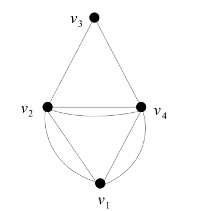

Նկար 2. Մուլտիգրաֆ

**Սահմանում 1.1.6:** Այն չկողմնորոշված գրաֆը, որտեղ կրկնակի կողերից բացի թույլատրվում են նաև օղակներ (կողեր $e = vv\ $ տեսքի), կոչվում է պսևդոգրաֆ:

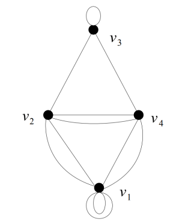

Նկար 3. Պսևդոգրաֆ

**Սահմանում 1.1.7:** Կողմնորոշված գրաֆ կոչվում է $D = (V,\ E)$ կարգավոր զույգը, որտեղ E-ն $V \times V$ դեկարտյան արտադրյալի ենթաբազմություն է, իսկ նրա տարրերն անվանում են կողմնորոշված կողեր կամ աղեղներ: $(u,v) \in E$ կողն ուղղված է u սկզբնական գագաթից դեպի v վերջնական գագաթը:

**Սահմանում 1.1.8 :** Այն դեպքում, երբ գրաֆի կողերին վերագրվում են որոշակի իրական թվային արժեքներ (օրինակ՝ հեռավորություն, կապի ինտենսիվություն կամ արժեք), գրաֆն անվանում են կշիռներով գրաֆ:

Գրաֆների հետ աշխատող ալգորիթմների ծրագրային իրականացման և համակարգչային հիշողության մեջ դրանց արդյունավետ պահպանման համար անհրաժեշտ է գրաֆները ներկայացնել տվյալների համապատասխան կառուցվածքների տեսքով: Գրաֆների ներկայացման հիմնական մաթեմատիկական և ծրագրային եղանակներն են հարևանության մատրիցը, կցության մատրիցը և հարևանության ցուցակներով ներկայացումը:

Դիցուք $G = (V,\ E)$-ն n գագաթներով գրաֆ է, որի գագաթները համարակալված են $V = \{ v_{1},\ v_{2},\ .\ .\ .\ ,\ v_{n}\}$:

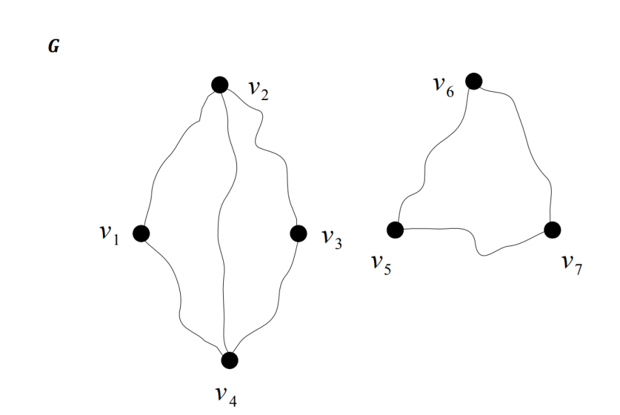

Նկար 4. G գրաֆ

**Սահմանում 1.1.9:** G գրաֆի հարևանության մատրից կոչվում է $A(G) = {(a_{ij})}_{n \times n\ }$ քառակուսային մատրիցը, որի $a_{ij}$ տարրը հավասար է 1-ի, եթե $v_{i}$ և $v_{j}$ գագաթները հարևան են $(\{ v_{i},v_{j}\} \in E)$, և 0՝ հակառակ դեպքում:

Չկողմնորոշված պարզ գրաֆի համար հարևանության մատրիցը միշտ սիմետրիկ է $(a_{ij} = a_{ji})$, իսկ գլխավոր անկյունագծի տարրերը հավասար են զրոյի $(a_{ii} = 0)$: Կողմնորոշված գրաֆի դեպքում $a_{ij} = 1$ այն և միայն այն դեպքում, երբ գոյություն ունի $v_{i}$-ից $v_{j}$ ուղղված $(v_{i},\ v_{j})$ կողը, ուստի կողմնորոշված գրաֆի հարևանության մատրիցն ընդհանուր առմամբ սիմետրիկ չէ: Հարևանության մատրիցի պահպանման համար պահանջվում է $\Theta(n^{2})$ հիշողություն:G գրաֆի(նկ.4) հարևանության մատրիցը կլինի՝

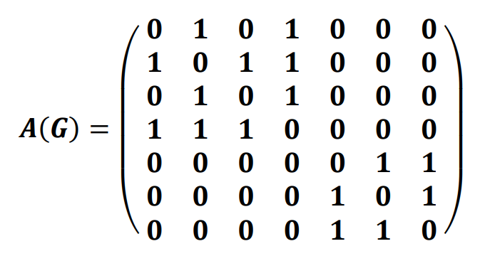

**Սահմանում 1.1.10:** n գագաթ (V={$v_{1},\ .\ .\ .\ ,\ v_{n}$}) և m կող ($E = \{ e_{1},\ .\ .\ .\ ,\ e_{n}\}$) ունեցող G գրաֆի կցության մատրից կոչվում է $B(G) = {(b_{ij})}_{n \times m}$ ուղղանկյուն մատրիցը: Չկողմնորոշված գրաֆի դեպքում $b_{ij} = 1$, եթե $v_{i}$ գագաթը կից է $e_{j}$ կողին, և 0՝ հակառակ դեպքում: Կողմնորոշված գրաֆի դեպքում $b_{ij} = - 1$, եթե $e_{j}$ կողը դուրս է գալիս $v_{i}$ գագաթից, $b_{ij} = + 1$, եթե $e_{j}$ կողը մտնում է $v_{i}$ գագաթ, և 0, եթե $v_{i}$ գագաթը կից չէ $e_{j}$ կողին: Կցության մատրիցն ունի $n \times m$ չափեր և պահանջում է $\Theta(n \bullet m)$ հիշողություն:G գրաֆի(նկ.4) կցության մատրիցը կլինի՝

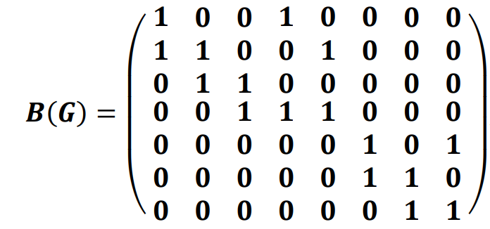

**Սահմանում 1.1.11:** Եթե G գրաֆում $V = \{ v_{1},\ v_{2},\ .\ .\ .\ ,\ v_{n}\}$, ապա G գրաֆի գագաթների հարևանության ցուցակներով ներկայացում կոչվում է n երկարությամբ զանգվածով տրվող համակարգը, որի i-րդ բաղադրիչն իրենից ներկայացնում է $v_{i}$ գագաթին հարևան գագաթների ցուցակը՝ գրված որևէ կարգով:

Այս եղանակն հատկապես արդյունավետ է համեմատաբար փոքր թվով կողեր պարունակող գրաֆների համար:Չկողմնորոշված G գրաֆի դեպքում բոլոր n ցուցակների երկարությունների գումարը հավասար է 2m-ի (քանի որ $\sum_{i = 1}^{n}{d(v_{i}) = 2m}$, որտեղ $d(v_{i})$-ն $v_{i}$ գագաթի աստիճանն է, իսկ m = \|E(G)\|-ն՝ կողերի քանակը): Այսպիսով, գրաֆի պահպանման համար պահանջվող համակարգչային հիշողության ծավալը համեմատական է n + m (կամ \|V(G)\| + \|E(G)\|) մեծությանը։

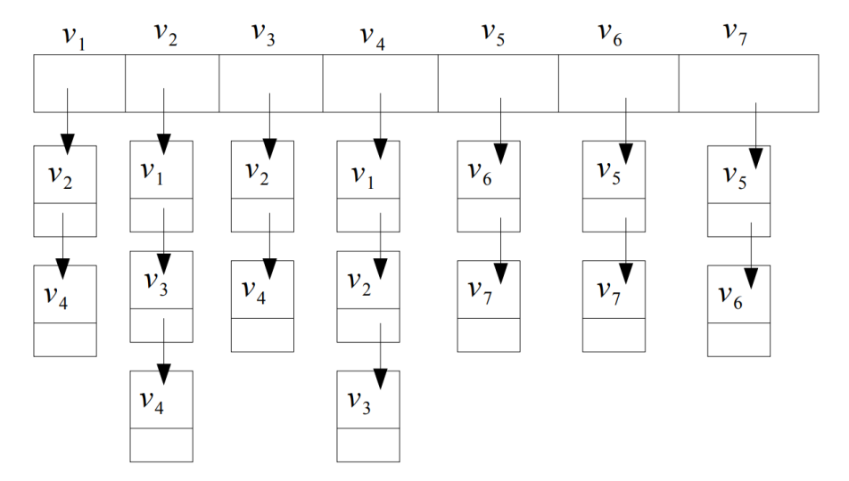

Նկար 5. Գրաֆի գագաթների հարևանության ցուցակնով ներկայացում

## 1.2 Աստիճաններ, ենթագրաֆներ, ճանապարհներ և ցիկլեր

Գրաֆների տեսության կարևորագույն տեղային (լոկալ) բնութագրիչներից է գագաթի աստիճանը, որն արտահայտում է տվյալ գագաթի կապվածության աստիճանը հարևան գագաթների հետ:

**Սահմանում 1.2.1:** G գրաֆում $v \in V(G)$ գագաթի աստիճան, որը նշանակվում է $d_{G}(v)$ (կամ համառոտ՝ d(v)) սիմվոլով, կոչվում է այդ գագաթին կից կողերի քանակը: Պարզ գրաֆների դեպքում գագաթի աստիճանը հավասար է նրա հարևան գագաթների քանակին:

Այն գագաթը, որի աստիճանը հավասար է զրոյի ($d(v) = 0$), անվանում են մեկուսացված գագաթ, իսկ $d(v) = 1$ աստիճան ունեցող գագաթը կոչվում է կախված (կամ ծայրային) գագաթ:

**Սահմանում 1.2.2:** G գրաֆի գագաթների աստիճանների փոքրագույն և մեծագույն արժեքները համապատասխանաբար կոչվում են գրաֆի նվազագույն աստիճան (նշանակվում է $\delta(G)$-ով) և առավելագույն աստիճան (նշանակվում է $\mathrm{\Delta}(G)$-ով), այսինքն՝ $\delta(G) = \min_{v \in V(G)}{d(v)}$ և $\mathrm{\Delta}(G) = \max_{v \in V(G)}{d(v)}$:

Ցանկացած n կարգի պարզ գրաֆի համար տեղի ունի $0 \leq \delta(G) \leq \mathrm{\Delta}(G) \leq n - 1$ անհավասարությունը: Այն դեպքում, երբ գրաֆի բոլոր գագաթներն ունեն միևնույն k աստիճանը ($\delta(G) = \mathrm{\Delta}(G) = k$), գրաֆն անվանում են k-համասեռ (կամ k-կանոնավոր):

Գրաֆի գագաթների աստիճանների և կողերի ընդհանուր քանակի միջև կապն արտահայտվում է դիսկրետ մաթեմատիկայի հիմնարար պնդումներից մեկով, որը հայտնի է որպես Ձեռքսեղմումների լեմմա:

**Թեորեմ 1.2.1 (Ձեռքսեղմումների լեմմա):** Կամայական G = (V, E) գրաֆում բոլոր գագաթների աստիճանների գումարը հավասար է կողերի քանակի կրկնապատիկին, այսինքն՝

$$\sum_{v \in V(G)}^{}{d(v) = 2|E(G)| = 2m}$$

Այս պնդման ապացույցը բխում է այն դիտարկումից, որ աստիճանների գումարը հաշվելիս յուրաքանչյուր e = uv կող հաշվվում է ճիշտ երկու անգամ՝ մեկ անգամ u գագաթի աստիճանում, և մեկ անգամ՝ v-ի: Ձեռքսեղմումների լեմմայից անմիջապես ստացվում է կարևոր հետևանք, համաձայն որի՝ ցանկացած գրաֆում կենտ աստիճան ունեցող գագաթների քանակը միշտ զույգ թիվ է:

Գրաֆների կառուցվածքային հատկությունների վերլուծության համար դիտարկվում են դրանց մասնակի ենթաբազմություններով ձևավորվող կառույցները՝ ենթագրաֆները:

**Սահմանում 1.2.3:** $H = (V_{H},E_{H})$ գրաֆը կոչվում է $G = (V,\ E)$ գրաֆի ենթագրաֆ (նշանակվում է $H \subseteq G$), եթե $V_{H} \subseteq V(G)$ և $E_{H} \subseteq E(G)$, ընդ որում $E_{H}$-ի յուրաքանչյուր կողի ծայրակետերը պատկանում են $V_{H}$ բազմությանը:

**Սահմանում 1.2.4:**$G = (V,\ E)$ գրաֆի H ենթագրաֆը կոչվում է $S \subseteq V$ գագաթների ենթաբազմությամբ ծնված ենթագրաֆ (նշանակվում է G\[S\]), եթե $V(H) = S$, և H-ը պարունակում է G գրաֆի բոլոր այն կողերը, որոնց երկու ծայրակետերն էլ պատկանում են S բազմությանը:

> 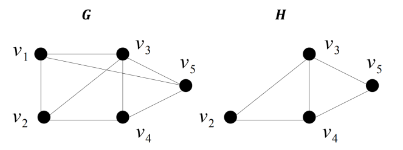
>
> Նկար 6. G գրաֆի բազմությամբ ծնված H ենթագրաֆ

**Սահմանում 1.2.5:** G գրաֆի H ենթագրաֆը կոչվում է կմախքային ենթագրաֆ, եթե $V(H) = V(G)$, այսինքն՝ H-ն ընդգրկում է G գրաֆի բոլոր գագաթները:

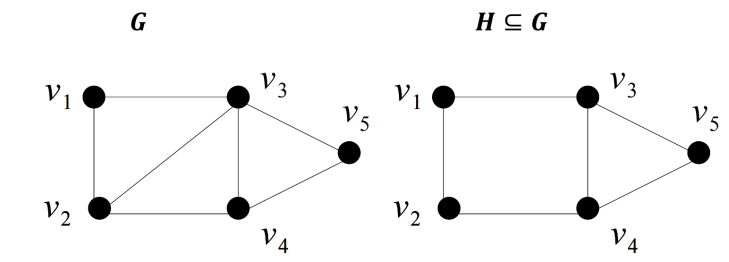

Նկար 7. G գրաֆի կմախքային H ենթագրաֆ

Գրաֆի գագաթների միջև տեղաշարժը և հաջորդական կապերն ուսումնասիրվում են շրջանցումների, ճանապարհների և ցիկլերի միջոցով:

**Սահմանում 1.2.6:** G գրաֆի գագաթների և կողերի $v_{1},\ e_{1},\ v_{2},\ e_{2},.\ .\ .\ ,\ e_{k},\ v_{k}$ հաջորդականությունը, որտեղ $e_{i} = \{ v_{i - 1},v_{i}\} \in E(G)$, կոչվում է $v_{0}$-ից $v_{k}$ շրջանցում, իսկ k թիվը՝ շրջանցման երկարություն:Եթե շրջանցման սկզբնական և վերջնական գագաթները համընկնում են ($v_{0}$= $v_{k}$), ապա այն կոչվում է փակ շրջանցում:

**Սահմանում 1.2.7:** Այն շրջանցումը, որում բոլոր կողերն տարբեր են, կոչվում է ճանապարհ: Եթե ճանապարհում բոլոր գագաթները (և հետևաբար նաև բոլոր կողերը) զույգ առ զույգ տարբեր են, ապա այն կոչվում է պարզ ճանապարհ:

**Սահմանում 1.2.8:** Փակ ճանապարհն անվանում են ցիկլ, իսկ այն ցիկլը, որում կրկնվում են միայն սկզբնական և վերջնական գագաթները ($v_{0} = v_{k}$), իսկ բոլոր միջանկյալ գագաթները տարբեր են, կոչվում է պարզ ցիկլ:k երկարությամբ պարզ ցիկլը նշանակվում է $C_{k}$ սիմվոլով:

Գրաֆի նվազագույն աստիճանի և նրանում երկար ճանապարհների ու ցիկլերի գոյության միջև կապը նկարագրվում է հետևյալ դասական պնդմամբ:

> **Թեորեմ 1.2.2 (Ռ. Դիստել):** Եթե G գրաֆի նվազագույն աստիճանը բավարարում է $\delta(G) \geq 2$ պայմանին, ապա G-ն պարունակում է առնվազն $\delta(G)$ երկարությամբ պարզ ճանապարհ և առնվազն $\delta(G) + 1$ երկարությամբ պարզ ցիկլ:

Այս թեորեմի ապացուցման համար դիտարկվում է G գրաֆի առավելագույն երկարությամբ $P = v_{1}v_{2}\ .\ .\ .\ \ v_{k}$ պարզ ճանապարհը:Քանի որ P-ն հնարավոր չէ երկարացնել,$v_{k}$ վերջնական գագաթի բոլոր հարևանները պետք է ընկած լինեն հենց P ճանապարհի վրա: Այստեղից հետևում է, որ $k \geq d(v_{k}) \geq \delta(G)$, ինչն ապացուցում է առնվազն $\delta(G)$ երկարությամբ պարզ ճանապարհի գոյությունը: Վերցնելով $v_{k}$-ի այն հարևան$\ v_{i}$ գագաթը, որն ունի փոքրագույն ինդեքսը P-ի վրա, ստանում ենք $v_{i}v_{i + 1}...v_{k}v_{i}$ պարզ ցիկլը, որի երկարությունը առնվազն $\delta(G) + 1$ է:

Գագաթների միջև հեռավորության ներմուծումը հնարավորություն է տալիս գրաֆի վրա դիտարկել մետրիկական տարածության հատկություններ:

**Սահմանում 1.2.9:** G գրաֆի u և v գագաթների միջև հեռավորություն (նշանակվում է $d(u,v)$-ով) կոչվում է դրանք միացնող կարճագույն պարզ ճանապարհի երկարությունը: Եթե u և v գագաթների միջև ճանապարհ չկա, ընդունվում է $d(u,v) = \infty$:

Հեռավորության ֆունկցիան բավարարում է մետրիկայի եռանկյան անհավասարությանը, այսինքն՝ կամայական $u,v,w \in V(G)$ գագաթների համար տեղի ունի $d(u,w) \leq d(u,v) + d(v,w)$ պայմանը:

**Սահմանում 1.2.10:** Կապակցված G գրաֆի $v \in V(G)$ գագաթի էքսցենտրիսիտետ է կոչվում նրանից ամենահեռու գտնվող գագաթի հեռավորությունը՝ $\varepsilon(v) = \max_{u \in V(G)}{d(v,u)}$: G գրաֆի գագաթների փոքրագույն էքսցենտրիսիտետը կոչվում է գրաֆի շառավիղ (նշանակվում է r(G)-ով), իսկ մեծագույն էքսցենտրիսիտետը՝ տրամագիծ (նշանակվում է $diam(G)$-ով), այսինքն՝$r(G) = \min_{v \in V(G)}{\varepsilon(v)\ }$և $diam(G) = \max_{v \in V(G)}{\varepsilon(v)\ }$:

Այն գագաթները, որոնց էքսցենտրիսիտետը հավասար է գրաֆի շառավղին ($\varepsilon(v) = r(G)$), կոչվում են կենտրոնական գագաթներ, իսկ դրանց բազմությունը կազմում է գրաֆի կենտրոնը: Ցանկացած կապակցված գրաֆի համար շառավղի և տրամագծի միջև տեղի ունի հետևյալ դասական անհավասարությունը. $r(G) \leq diam(G) \leq 2r(G)$:

## 1.3 Կապակցվածություն, ծառեր և երկկողմանի գրաֆներ

Գրաֆների տեսության մեջ կենտրոնական հասկացություններից է գրաֆի կապակցվածությունը, որը նկարագրում է գագաթների միջև փոխադարձ հասանելիությունը:

**Սահմանում 1.3.1:** G գրաֆը կոչվում է կապակցված, եթե նրա ցանկացած երկու $u,v \in V(G)$ գագաթների համար G գրաֆում գոյություն ունի դրանք միացնող $(u,v)$-ճանապարհ:

Հակառակ դեպքում գրաֆն անվանում են անպատշաճ կամ անհամասեռ (կամ պարզապես չկապակցված): Կամայական G գրաֆի գագաթների բազմության վրա կարելի է ներմուծել «միացված լինելու» բինար հարաբերությունը. $u \sim v$ այն և միայն այն դեպքում, երբ $u = v$ կամ G-ում գոյություն ունի u և v գագաթները միացնող պարզ ճանապարհ: Այս հարաբերությունը հանդիսանում է համարժեքության հարաբերություն, քանի որ այն օժտված է ռեֆլեքսիվության, սիմետրիկության և տրանզիտիվության հատկություններով։

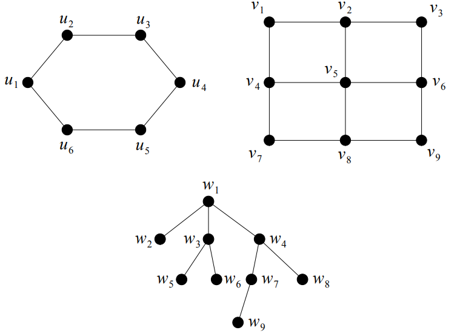

Նկար 8. Կապակցված գրաֆներ

**Սահմանում 1.3.2:** G գրաֆի գագաթների բազմության տրոհումից առաջացած համարժեքության դասերով ծնված ենթագրաֆները կոչվում են G գրաֆի կապակցվածության բաղադրիչներ:

Գրաֆի կապակցվածության բաղադրիչների քանակը նշանակվում է k(G) (կամ c(G)) սիմվոլով: Գրաֆը կապակցված է այն և միայն այն դեպքում, երբ k(G) = 1:

Կապակցվածության պահպանման տեսանկյունից առանձնահատուկ դեր ունեն այն գագաթներն ու կողերը, որոնց հեռացումը խախտում է գրաֆի ամբողջականությունը:

**Սահմանում 1.3.3:** G գրաֆի $v \in V(G)$ գագաթը կոչվում է միակցման կետ (կամ կտրող գագաթ), եթե $G - v$ ենթագրաֆն ունի կապակցվածության ավելի շատ բաղադրիչներ, քան G գրաֆը ($k(G - v) > k(G)$): Նմանապես, $e \in E(G)$ կողը կոչվում է կամուրջ (կամ կտրող կող), եթե $G - e$ ենթագրաֆի կապակցվածության բաղադրիչների քանակն ավելի մեծ է, քան G գրաֆինը ($k(G - e) > k(G)$):

Կամուրջների կառուցվածքային բնութագրումը տրվում է հետևյալ դասական պնդմամբ:

**Թեորեմ 1.3.1 (Ռ. Դիստել):** G գրաֆի $e \in E(G)$ կողը հանդիսանում է կամուրջ այն և միայն այն դեպքում, երբ այն չի պատկանում G գրաֆի որևէ պարզ ցիկլի:

Այս թեորեմի ապացույցն անմիջապես բխում է այն դիտարկումից, որ եթե e = uv կողը պատկանում է որևէ C պարզ ցիկլի, ապա e-ն հեռացնելուց հետո u և v գագաթների միջև կապը պահպանվում է $C - e$ պարզ ճանապարհով, ուստի կապակցվածության բաղադրիչների քանակը չի փոխվում: Հակառակ ուղղությամբ, եթե e = uv-ն կամուրջ չէ, ապա $G - e$ գրաֆում գոյություն ունի u և v գագաթները միացնող P պարզ ճանապարհ, որին e կողն ավելացնելիս ստացվում է e կողը պարունակող պարզ ցիկլ:

Դիսկրետ մաթեմատիկայում և դրա կիրառություններում առանձնահատուկ տեղ են գրավում պարզագույն կապակցված գրաֆները՝ ծառերը:

**Սահմանում 1.3.4 :** Ցիկլ չպարունակող կապակցված գրաֆը կոչվում է ծառ:

**Սահմանում 1.3.5:** Ցիկլ չպարունակող կամայական գրաֆը կոչվում է անտառ:

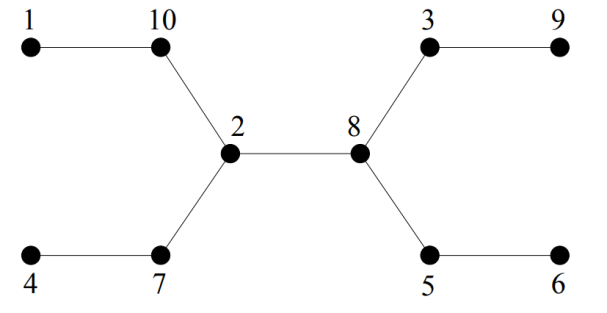

Նկար 9. Ծառ

Այսպիսով, անտառը այնպիսի գրաֆ է, որի կապակցվածության բոլոր բաղադրիչները ծառեր են: Ծառերի կառուցվածքային հատկություններն օժտված են բազմաթիվ հավասարազոր բնութագրումներով, որոնք ամփոփված են հետևյալ հիմնարար թեորեմում:

**Թեորեմ 1.3.2 (Դ. Բ. Վեսթի):** n գագաթ (\|V(G)\| = n) և m կող (\|E(G)\| = m) ունեցող G = (V, E) գրաֆի համար հետևյալ պնդումները հավասարազոր են.

1.  G-ն ծառ է:

2.  G գրաֆում ցանկացած երկու գագաթ միացված են ճիշտ մեկ պարզ ճանապարհով:

3.  G-ն կապակցված է և m = n - 1:

4.  G-ն չունի ցիկլ և m = n - 1:

5.  G-ն չունի ցիկլ, սակայն նրանում ցանկացած երկու ոչ հարևան գագաթների միջև նոր կող ավելացնելիս առաջանում է ճիշտ մեկ պարզ ցիկլ:

Այս թեորեմի ապացույցը կատարվում է շրջանաձև հետևողականությամբ: (1)-ից (2) պնդման անցումը բխում է նրանից, որ եթե երկու գագաթների միջև գոյություն ունենային երկու տարբեր պարզ ճանապարհներ, ապա դրանց միավորումը կպարունակեր ցիկլ, ինչը հակասում է ծառի սահմանմանը: (2)-ից (3) անցումն ապացուցվում է մաթեմատիկական ինդուկցիոն եղանակով ըստ գագաթների քանակի. կամայական կողի հեռացումը գրաֆը տրոհում է կապակցվածության երկու բաղադրիչների, որոնցից յուրաքանչյուրը բավարարում է ինդուկցիոն ենթադրությանը: (3)-ից (4) անցման համար, եթե գրաֆում գոյություն ունենար ցիկլ, ապա ցիկլի կողերից մեկի հեռացումը չէր խախտի կապակցվածությունը, և այդ գործընթացի շարունակումը կհանգեցներ կապակցված գրաֆի՝ $n - 1$-ից փոքր թվով կողերով, ինչն անհնար է: Վերջապես, (4)-ից (5) և (5)-ից (1) անցումները հաստատում են, որ ծառերը հանդիսանում են մինիմալ կապակցված և մաքսիմալ ացիկլիկ գրաֆներ:

Ծառերի կարևոր տարրերից են աստիճանով փոքրագույն գագաթները: $|V(G)| \geq 2$ գագաթներով ցանկացած ծառ պարունակում է առնվազն երկու կախված (ծայրային) գագաթ, այսինքն՝ գագաթներ, որոնց աստիճանը հավասար է 1-ի (d(v) = 1):

**Սահմանում 1.3.6:** G գրաֆի T ենթագրաֆը կոչվում է կմախքային ծառ , եթե T-ն ծառ է և $V(T) = V(G)$:

Կամայական կապակցված գրաֆ պարունակում է առնվազն մեկ կմախքային ծառ: Կմախքային ծառ ստանալու համար բավական է գրաֆի ցիկլերից հերթականորեն հեռացնել կողեր այնքան ժամանակ, քանի դեռ գրաֆում պահպանվում է կապակցվածությունը և վերանում են բոլոր ցիկլերը:

Գրաֆների կառուցվածքային տեսության մեջ առանձնահատուկ նշանակություն ունեն այն գրաֆները, որոնց գագաթների բազմությունը կարելի է տրոհել երկու անկախ ենթաբազմությունների:

**Սահմանում 1.3.7:**$G = (V,E)$ գրաֆը կոչվում է երկկողմանի գրաֆ, եթե նրա V(G) գագաթների բազմությունը կարելի է տրոհել երկու ոչ դատարկ չհատվող X և Y ենթաբազմությունների ($V(G) = X \cup Y$, $X \cap Y = \oslash$) այնպես, որ G գրաֆի յուրաքանչյուր կողմի մի ծայրակետը պատկանի X-ին, իսկ մյուսը՝ Y-ին: (X, Y) զույգն անվանում են գրաֆի երկկողմանի տրոհում:

**Սահմանում 1.3.8:** Այն երկկողմանի գրաֆը, որտեղ X բազմության յուրաքանչյուր գագաթ միացված է Y բազմության բոլոր գագաթներին, կոչվում է լրիվ երկկողմանի գրաֆ: Եթե $|X| = m$ և $|Y| = n$, ապա այդպիսի գրաֆը նշանակվում է $K_{m,n}$ սիմվոլով:

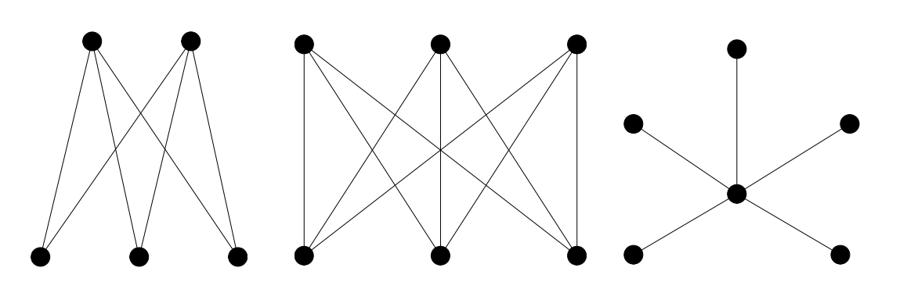

Նկար 10. $K_{2,3}\ ,\ K_{3,3}\ $ գրաֆներ և $K_{1,5}$ աստղ

$K_{m,n}$ գրաֆի գագաթների քանակը հավասար է m + n-ի, իսկ կողերի քանակը՝ $m \bullet n -$ ի: $K_{1,n}$ տեսքի լրիվ երկկողմանի գրաֆներն անվանում են աստղեր:

Երկկողմանի գրաֆների հիմնարար կառուցվածքային բնութագրումը տրվում է Դ. Կյոնիգի հայտնի թեորեմով:

**Թեորեմ 1.3.3 (Դ. Կյոնիգ):** G գրաֆը երկկողմանի է այն և միայն այն դեպքում, երբ այն չի պարունակում կենտ երկարությամբ պարզ ցիկլ:

Այս թեորեմի ապացույցի անհրաժեշտության մասը պարզ է, քանի որ եթե գրաֆը երկկողմանի է, ապա ցանկացած շրջանցման ընթացքում գագաթները հերթագայում են X և Y բազմությունների միջև, ուստի յուրաքանչյուր փակ ճանապարհ (և հետևաբար յուրաքանչյուր պարզ ցիկլ) պետք է պարունակի զույգ թվով կողեր: Բավարարության ապացուցման համար նախ ենթադրվում է, որ գրաֆը կապակցված է (անպատշաճ դեպքում պնդումը կիրառվում է յուրաքանչյուր կապակցվածության բաղադրիչի համար): Ֆիքսելով կամայական $v_{0} \in V(G)$ գագաթ՝ V(G) բազմությունը տրոհվում է երկու մասի. X բազմության մեջ ընդգրկվում են այն գագաթները, որոնց հեռավորությունը $v_{0}$-ից զույգ թիվ է ($d(v_{0},x)$-ն զույգ է), իսկ Y բազմության մեջ՝ այն գագաթները, որոնց հեռավորությունը $v_{0}$-ից կենտ թիվ է: Եթե գոյություն ունենար կող նույն բազմության (օրինակ՝ X-ի) երկու u և w գագաթների միջև, ապա $v_{0}$-ից u և $v_{0}$-ից w կարճագույն ճանապարհները uw կողի հետ միասին կկազմեին կենտ երկարությամբ փակ շրջանցում, որից կարելի էր անջատել կենտ պարզ ցիկլ, ինչը հակասում է թեորեմի պայմանին: Այսպիսով, X և Y բազմությունները կազմում են G գրաֆի երկկողմանի տրոհում:

## 1.4 Հարթ գրաֆներ: Էյլերի բանաձևը, Կուրատովսկու թեորեմը, երկակի գրաֆ

Գրաֆների տեսության և երկրաչափության հատման տիրույթում առանցքային տեղ են գրավում այն գրաֆները, որոնք հնարավոր է պատկերել հարթության վրա՝ առանց կողերի ինքնահատման:

**Սահմանում 1.4.1:** G գրաֆը կոչվում է հարթեցնելի (կամ պլանար, planar graph), եթե այն հնարավոր է պատկերել հարթության վրա այնպես, որ նրա կողերը պատկերող անընդհատ կորերը չունենան ընդհանուր կետեր, բացառությամբ իրենց ծայրակետերի (գագաթների): Հարթության վրա այդպիսի կոնկրետ պատկերված գրաֆն անվանում են հարթ գրաֆ (plane graph) կամ գրաֆի հարթ պատկերում:

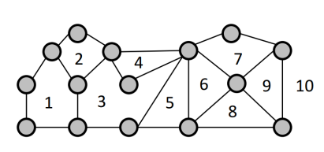

Նկար 11. Հարթ գրաֆ՝ n = 15 գագաթով, m = 23 կողով և f = 10 նիստով

Հարթ գրաֆի կողերը հարթությունը տրոհում են մի քանի կապակցված տիրույթների, որոնք կոչվում են գրաֆի նիստեր:

**Սահմանում 1.4.2:** Հարթության վրա G հարթ գրաֆի կողերով սահմանափակված կապակցված տիրույթները կոչվում են G գրաֆի նիստեր: Յուրաքանչյուր հարթ գրաֆ ունի ճիշտ մեկ անսահմանափակ (արտաքին) նիստ, իսկ մնացած բոլոր նիստերը սահմանափակ են (ներքին):

Նիստի սահմանը կազմող կողերի և գագաթների հաջորդականությունը կոչվում է տվյալ նիստի եզր: Ի. Ֆարիի և Կ. Վագների հայտնի թեորեմի համաձայն՝ ցանկացած պարզ հարթ գրաֆ կարելի է պատկերել հարթության վրա այնպես, որ նրա բոլոր կողերը լինեն ուղղագիծ հատվածներ:

Հարթ գրաֆի գագաթների, կողերի և նիստերի քանակների միջև գոյություն ունի հիմնարար առնչություն, որն առաջին անգամ հայտնաբերել է Լ. Էյլերը 1752 թվականին:

**Թեորեմ 1.4.1 (Էյլերի բանաձևը):** Եթե կապակցված հարթ G գրաֆն ունի n գագաթ, m կող և f նիստ, ապա տեղի ունի հետևյալ հավասարությունը.

$n - m + f = 2$

Ապացույց: Թեորեմն ապացուցվում է մաթեմատիկական ինդուկցիայի եղանակով ըստ կողերի m քանակի: Ինդուկցիայի բազան դիտարկվում է ծառերի համար. եթե G-ն n գագաթով ծառ է, ապա նրանում ցիկլեր չկան, ուստի այն ունի ճիշտ մեկ (արտաքին) նիստ (f = 1), իսկ կողերի քանակը հավասար է$m = n - 1$: Այս դեպքում$\ n - (n - 1) + 1 = 2$, և բանաձևը ճիշտ է: Ենթադրենք, թեորեմը ճիշտ է $m - 1$ կող ունեցող բոլոր կապակցված հարթ գրաֆների համար: Եթե G գրաֆում առկա է ցիկլ, ապա վերցնենք այդ ցիկլին պատկանող որևէ e կող: Այդ կողը սահմանազատում է երկու տարբեր նիստեր, ուստի e կողը հեռացնելիս ստացված $G - e$ գրաֆում նիստերի քանակը պակասում է մեկով (դառնալով $f - 1$), իսկ կապակցվածությունը պահպանվում է: Ըստ ինդուկցիոն ենթադրության՝ $G - e$ գրաֆի համար տեղի ունի $n - (m - 1) + (f - 1) = 2$ հավասարությունը, որից անմիջապես ստացվում է $n - m + f = 2$ բանաձևը:

Այն դեպքում, երբ հարթ գրաֆը չկապակցված է և ունի k(G) հատ կապակցվածության բաղադրիչ, Էյլերի բանաձևն ընդունում է $n - m + f = 1 + k(G)$ ընդհանրացված տեսքը: Էյլերի բանաձևը թույլ է տալիս ստանալ կարևոր վերին գնահատականներ հարթ գրաֆի կողերի քանակի համար:

**Հետևանք 1.4.1:** Ցանկացած $n \geq 3$ գագաթներով պարզ հարթ գրաֆի կողերի քանակը բավարարում է $m \leq 3n - 6$ անհավասարությանը: Եթե, բացի այդ, գրաֆը չի պարունակում եռանկյուններ (օրինակ՝ երկկողմանի հարթ գրաֆ է), ապա տեղի ունի առավել խիստ $m \leq 2n - 4$ անհավասարությունը:

Այս գնահատականների միջոցով անմիջապես ապացուցվում է, որ $K_{5}$ լրիվ գրաֆը և $K_{3,3}$ լրիվ երկկողմանի գրաֆը հարթ չեն: Իրոք, $K_{5}$ գրաֆն ունի n = 5 գագաթ և m = 10 կող, սակայն $3n - 6 = 9 < 10$: Նմանապես, $K_{3,3}$ գրաֆն ունի n = 6 գագաթ, m = 9 կող և չի պարունակում եռանկյուններ, սակայն$\ 2n - 4 = 8 < 9$:

Գրաֆի հարթայնության (պլանարության) բնութագրումը հանդիսանում է դիսկրետ մաթեմատիկայի ամենագեղեցիկ արդյունքներից մեկը: Որպեսզի գրաֆը լինի հարթ, անհրաժեշտ է, որ այն չպարունակի $K_{5}$ կամ $K_{3,3}$ գրաֆների «բարդացված» տարբերակներ:

**Սահմանում 1.4.3:**G գրաֆի ենթատրոհում կոչվում է այն գրաֆը, որը ստացվում է G-ից՝ նրա կողերի վրա նոր 2-աստիճանով գագաթներ ավելացնելու (կողերը ճանապարհներով փոխարինելու) գործողության հաջորդական կիրառման արդյունքում:

Հարթայնության դասական հայտանիշը սահմանվել է Լ. Պոնտրյագինի (1927) և Կ. Կուրատովսկու (1930) կողմից:

**Թեորեմ 1.4.2 (Պոնտրյագին-Կուրատովսկի):** G գրաֆը հարթ է այն և միայն այն դեպքում, երբ այն չի պարունակում ենթագրաֆ, որն հանդիսանում է $K_{5}$ կամ $K_{3,3}$ գրաֆների ենթատրոհում:

Կ. Վագները 1937 թվականին առաջարկեց Կուրատովսկու թեորեմի այլընտրանքային ձևակերպումը՝ հիմնված գրաֆի մինորի հասկացության վրա:

**Թեորեմ 1.4.3 (Կ. Վագներ):** G գրաֆը հարթ է այն և միայն այն դեպքում, երբ այն չի պարունակում $K_{5}$ կամ $K_{3,3}$ գրաֆները որպես մինոր (այսինքն՝ չի ստացվում դրանցից կողերի հեռացման և սեղմման գործողությունների միջոցով):

Հարթ գրաֆների տեսության մեջ կարևոր դեր ունի երկակիության (դուալության) հասկացությունը, որը սահմանում է փոխմիարժեք համապատասխանություն սկզբնական գրաֆի նիստերի և երկակի գրաֆի գագաթների միջև:

**Սահմանում 1.4.4:** Դիցուք տրված է G հարթ գրաֆը: G գրաֆի երկակի գրաֆ (dual graph) կոչվում է այն $G^{\ast}$ գրաֆը (կամ մուլտիգրաֆը), որը կառուցվում է հետևյալ կերպ. G գրաֆի յուրաքանչյուր $f_{i}$ նիստի ներսում ընտրվում է մեկական ${v_{i}}^{\ast}$ գագաթ, իսկ G գրաֆի յուրաքանչյուր e կողի համար, որը սահմանազատում է $f_{i}$ և $f_{j}$ նիստերը, $G^{\ast}$-ում տարվում է $e^{\ast} = {v_{i}}^{\ast}{v_{j}}^{\ast}$ կողը, որը հատում է ճիշտ e կողը: Եթե e կողը կամուրջ է և երկու կողմից սահմանակից է նույն նիստին, ապա $G^{\ast}$-ում առաջանում է օղակ:

Երկակի գրաֆի հիմնական պարամետրերի միջև կապը նկարագրվում է հետևյալ պնդմամբ:

**Թեորեմ 1.4.4 :** Եթե կապակցված հարթ G գրաֆն ունի n գագաթ, m կող և f նիստ, իսկ նրա $G^{\ast}$ երկակի գրաֆն ունի $n^{\ast}$ գագաթ, $m^{\ast}$ կող և $f^{\ast}$ նիստ, ապա տեղի ունեն հետևյալ առնչությունները.

$$n^{\ast} = f,\ m^{\ast} = m\ ,\ f^{\ast} = n\ \ $$

Ավելին, կապակցված հարթ գրաֆի համար երկակի գրաֆի երկակի գրաֆը իզոմորֆ է սկզբնական գրաֆին (${(G^{\ast})}^{\ast} \cong G$): Երկակիության հասկացությունը հնարավորություն է տալիս հարթ գրաֆի նիստերի ներկման խնդիրը (օրինակ՝ քարտեզների ներկումը) հանգեցնել նրա երկակի գրաֆի գագաթների ներկման դասական խնդրին:

# ԳԼՈՒԽ 2. ԳՐԱՖՆԵՐԻ ԳՈՒՆԱՎՈՐՄԱՆ ՏԵՍՈՒԹՅՈՒՆ

## 2.1 Գագաթային ներկումներ, քրոմատիկ թիվ, վերին և ստորին գնահատականներ (Բրուքսի թեորեմ)

Գրաֆների գունավորման տեսությունը դիսկրետ մաթեմատիկայի և կոմբինատոր օպտիմալացման ամենաակտիվ ու լայնորեն կիրառվող բաժիններից է, որի պատմական արմատները հանգում են քարտեզների ներկման դասական խնդիրներին: Գրաֆի գագաթային ներկման հիմնական գաղափարը գրաֆի գագաթներին որոշակի գույների (կամ թվային ինդեքսների) վերագրումն է այնպես, որ հարևան գագաթներն ստանան տարբեր գույներ:

**Սահմանում 2.1.1:** $G = (V,\ E)$ գրաֆի գագաթային ճիշտ k-ներկում կոչվում է $c:V(G) \rightarrow \{ 1,2,.\ .\ .\ ,\ k\}$ արտապատկերումը, որի դեպքում ցանկացած երկու հարևան գագաթներ ստանում են տարբեր գույներ, այսինքն՝ ցանկացած $uv \in E(G)$ կողի համար տեղի ունի $c(u) \neq c(v)$ պայմանը: Եթե գրաֆի համար գոյություն ունի ճիշտ k-ներկում, ապա G-ն անվանում են k-ներկելի գրաֆ:

Գագաթային ճիշտ ներկման դեպքում միևնույն գույնն ստացած գագաթների բազմությունը կոչվում է գունային դաս: Քանի որ հարևան գագաթները չեն կարող ունենալ նույն գույնը, յուրաքանչյուր գունային դաս իրենից ներկայացնում է անկախ բազմություն, այսինքն՝ բազմություն, որի ոչ մի երկու գագաթ հարևան չեն: Այսպիսով, գրաֆի ճիշտ k-ներկումը համարժեք է նրա V(G) գագաթների բազմության տրոհմանը k հատ անկախ ենթաբազմությունների:

**Սահմանում 2.1.2:** G գրաֆի քրոմատիկ թիվ, որը նշանակվում է $\chi(G)$ սիմվոլով, կոչվում է այն նվազագույն k թիվը, որի համար գոյություն ունի G գրաֆի գագաթային ճիշտ k-ներկում: Այն գրաֆը, որի քրոմատիկ թիվը հավասար է k-ի ($\chi(G) = k$), կոչվում է k-քրոմատիկ գրաֆ:

Օրինակ, n գագաթանի լրիվ գրաֆի համար $\chi(K_{n}) = n$, քանի որ բոլոր գագաթները զույգ առ զույգ հարևան են: Զույգ երկարությամբ պարզ ցիկլերի համար $\chi(C_{2k}) = 2$, իսկ կենտ երկարությամբ պարզ ցիկլերի համար՝ $\chi(C_{2k + 1}) = 3$: Ըստ Դ. Կյոնիգի թեորեմի, $\chi(G) \leq 2\ $ պայմանին բավարարում են այն և միայն այն գրաֆները, որոնք երկկողմանի են:

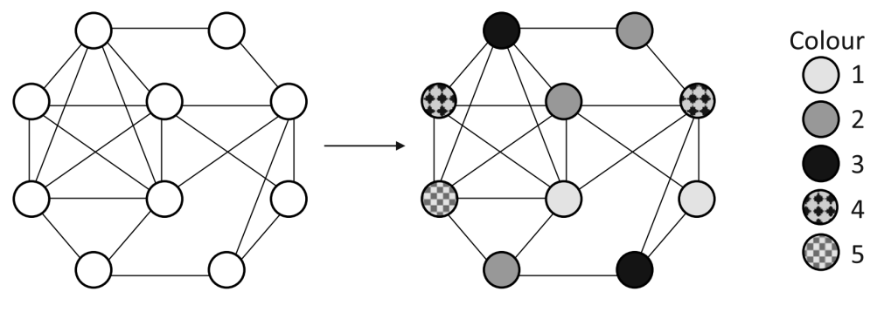

Նկար 12. Փոքր գրաֆ և դրան համապատասխան գունավորում

Քրոմատիկ թվի ճշգրիտ հաշվումն ընդհանուր դեպքում հանդիսանում է ալգորիթմորեն բարդ (NP-լրիվ) խնդիր, ուստի գրաֆների տեսության մեջ առանձնահատուկ նշանակություն ունեն $\chi(G)$-ի համար ստորին և վերին գնահատականների ստացումը՝ արտահայտված գրաֆի այլ կառուցվածքային պարամետրերով:

**Ստորին գնահատականներ:** Քրոմատիկ թվի պարզագույն ստորին գնահատականը կապված է գրաֆի խտության հետ: G գրաֆի խտությունը, որը նշանակվում է $\omega(G)$ սիմվոլով, կոչվում է G գրաֆում լրիվ ենթագրաֆ կազմող գագաթների առավելագույն քանակը: Քանի որ լրիվ ենթագրաֆի բոլոր գագաթները զույգ առ զույգ հարևան են, դրանց ներկման համար պահանջվում են տարբեր գույներ, որտեղից ստացվում է $\chi(G) \geq \omega(G)\ $ անհավասարությունը:

Մեկ այլ կարևոր ստորին գնահատական հիմնված է գրաֆի անկախության թվի վրա: G գրաֆի անկախության թիվ, որը նշանակվում է $\alpha(G)$ սիմվոլով, կոչվում է G գրաֆի անկախ գագաթների ենթաբազմության առավելագույն չափը: Քանի որ ճիշտ $\chi(G)$-ներկման դեպքում յուրաքանչյուր գունային դաս անկախ բազմություն է, ապա ոչ մի գունային դաս չի կարող պարունակել $\alpha(G)$-ից ավելի գագաթներ: Այստեղից անմիջապես բխում է հետևյալ ստորին գնահատականը.

$$\chi(G) \geq \frac{|V(G)|}{\alpha(G)} = \frac{n}{\alpha(G)}$$

**Վերին գնահատականներ:** Քրոմատիկ թվի պարզագույն վերին գնահատականը ստացվում է ագահ (Greedy) ալգորիթմի վերլուծությունից: Եթե գրաֆի գագաթները ներկենք հաջորդաբար՝ յուրաքանչյուր գագաթին վերագրելով նրա հարևանների կողմից չօգտագործված առաջին հասանելի գույնը, ապա ցանկացած v գագաթի ներկման պահին նրա արդեն ներկված հարևանների քանակը չի գերազանցում $d(v) \leq \mathrm{\Delta}(G)\ $ մեծությունը: Հետևաբար, v գագաթի համար միշտ հասանելի է առաջին $\mathrm{\Delta}(G) + 1$ գույներից առնվազն մեկը, որտեղից ստացվում է հետևյալ դասական վերին գնահատականը.

$$\chi(G) \leq \mathrm{\Delta}(G) + 1$$

$\chi(G) \leq \mathrm{\Delta}(G) + 1$ գնահատականը ցույց է տալիս, որ գրաֆի քրոմատիկ թիվը չի կարող գերազանցել նրա առավելագույն աստիճանը ավելացրած մեկ: Սակայն Ռ. Բրուքսը (1941) ապացուցեց, որ այս վերին գնահատականը ճշգրիտ հավասարության է վերածվում միայն երկու բացառիկ դեպքերում:

**Թեորեմ 2.1.1 (Ռ. Բրուքս, 1941):** Եթե G-ն կապակցված պարզ գրաֆ է, որը չի հանդիսանում լրիվ գրաֆ ($K_{n}$) և չի հանդիսանում կենտ երկարությամբ պարզ ցիկլ ($C_{2k + 1}$), ապա նրա քրոմատիկ թիվը բավարարում է հետևյալ խիստ վերին գնահատականին.

$$\chi(G) \leq \mathrm{\Delta}(G)$$

Ապացույցի գաղափարը: Թեորեմի ապացույցը կատարվում է ըստ $\mathrm{\Delta}(G) = \mathrm{\Delta}$ արժեքի վերլուծության: Եթե $\mathrm{\Delta} = 0$ կամ $\mathrm{\Delta} = 1$, ապա կապակցված գրաֆը $K_{1}$ կամ $K_{2}$ է, որոնք լրիվ գրաֆներ են: Եթե $\mathrm{\Delta} = 2$, ապա կապակցված գրաֆը կամ պարզ ճանապարհ է, կամ պարզ ցիկլ: Պարզ ճանապարհների և զույգ ցիկլերի համար $\chi(G) = 2 = \mathrm{\Delta}$, իսկ կենտ ցիկլերի համար $\chi(C_{2k + 1}) = 3 = \mathrm{\Delta} + 1$, ինչը համապատասխանեցվում է թեորեմի բացառություններին:

$\mathrm{\Delta} \geq 3$ դեպքում ապացույցը հիմնվում է գրաֆի 2-կապակցվածության վերլուծության վրա: Եթե գրաֆը 2-կապակցված չէ (ունի միակցման կետ), ապա պնդումն ապացուցվում է ինդուկցիայով ըստ գրաֆի մասերի: Եթե գրաֆը 2-կապակցված է, ապա գոյություն ունեն այնպիսի $u,v \in V(G)$ գագաթներ, որոնք գտնվում են 2 հեռավորության վրա ($d(u,v) = 2$), ուստի հարևան չեն, սակայն ունեն ընդհանուր հարևան, ընդ որում $G - \{ u,v\}$ ենթագրաֆը կապակցված է: Գագաթները կարելի է համարակալել $v_{1},\ v_{2},\ .\ .\ .,v_{n}\ $ այնպես, որ$v_{1} = u$,${\ v}_{2} = v,$, իսկ յուրաքանչյուր $v_{1}$ ($i < n$) ունենա առնվազն մեկ հարևան ավելի մեծ ինդեքսով գագաթների շարքում: Այդ դեպքում, կիրառելով ագահ ալգորիթմը նշված համարակալման համաձայն, $v_{1}$և $v_{2}$ գագաթներն ստանում են միևնույն 1-ին գույնը, իսկ վերջին $v_{n}$ գագաթն ունենում է առնվազն երկու հարևան ($v_{1}$-ը և $v_{2}$-ը), որոնք ներկված են նույն գույնով: Հետևաբար, $v_{n}$-ի հարևաններն օգտագործում են առավելագույնը $\mathrm{\Delta} - 1\ $ տարբեր գույներ, ինչը հնարավորություն է տալիս $v_{n}$ գագաթին վերագրել հասանելի $\mathrm{\Delta}$ գույներից մեկը: Այսպիսով, ստացվում է G գրաֆի ճիշտ $\mathrm{\Delta}$-ներկում:

## 2.2 Կողային ներկումներ (Քյոնիգի և Վիզինգի թեորեմներ)

Գրաֆների գունավորման տեսության մեջ, գագաթային ներկումներից բացի, հիմնարար տեղ են գրավում կողային ներկումները, որտեղ ներկման օբյեկտ են հանդիսանում գրաֆի կողերը: Կողային ներկման հիմնական պահանջն է, որ կից կողերն ստանան տարբեր գույներ:

**Սահմանում 2.2.1:** $G = (V,E)$ գրաֆի կողային ճիշտ k-ներկում կոչվում է $c\prime:E(G) \rightarrow \{ 1,\ 2,\ .\ .\ .\ ,k\}\ $ արտապատկերումը, որի դեպքում ցանկացած երկու կից կողեր ստանում են տարբեր գույներ, այսինքն՝ եթե $e_{1},\ e_{2} \in E(G)$ կողերն ունեն ընդհանուր ծայրակետ, ապա $c\prime(e_{1}) \neq \ c\prime(e_{2})$:

**Սահմանում 2.2.2:** G գրաֆի կողային քրոմատիկ թիվ (կամ քրոմատիկ ինդեքս), որը նշանակվում է $\chi\prime(G)$ սիմվոլով, կոչվում է այն նվազագույն k թիվը, որի համար գոյություն ունի G գրաֆի կողային ճիշտ k-ներկում:

Քանի որ $v \in V(G)$ գագաթին կից բոլոր d(v) կողերը զույգ առ զույգ կից են միմյանց, դրանցից յուրաքանչյուրը պետք է ստանա տարբեր գույն: Այստեղից անմիջապես բխում է կողային քրոմատիկ թվի բնական ստորին գնահատականը. ցանկացած գրաֆի համար տեղի ունի $\chi\prime(G) \geq \mathrm{\Delta}(G)$ անհավասարությունը, որտեղ $\mathrm{\Delta}(G)$-ն գրաֆի առավելագույն աստիճանն է:

Երկկողմանի գրաֆների դասում կողային քրոմատիկ թվի ստորին գնահատականը վերածվում է ճշգրիտ հավասարության: Այս հիմնարար արդյունքն ապացուցվել է Դ. Քյոնիգի կողմից 1916 թվականին:

**Թեորեմ 2.2.1 (Դ. Քյոնիգ, 1916):** Ցանկացած G երկկողմանի մուլտիգրաֆի կողային քրոմատիկ թիվը հավասար է նրա առավելագույն աստիճանին, այսինքն՝

$$\chi\prime(G) = \mathrm{\Delta}(G)$$

Ապացույցի գաղափարը: Թեորեմն ապացուցվում է ինդուկցիայով ըստ կողերի քանակի: Ենթադրենք $G - e\ $ գրաֆն արդեն ճիշտ ներկված է $\mathrm{\Delta}(G)$ գույներով, որտեղ $e = uv \in E(G)$: Եթե գոյություն ունի գույն, որն օգտագործված չէ ո՛չ u, ո՛չ v գագաթների մոտ, ապա այդ գույնը վերագրվում է e կողին: Հակառակ դեպքում դիտարկվում է u գագաթի մոտ բացակայող α գույնը և v գագաթի մոտ բացակայող β գույնը: Դիտարկելով միայն α և β գույների կողերով ձևավորված ենթագրաֆը՝ ստանում ենք պարզ ճանապարհների և ցիկլերի հավաքածու: Քանի որ G-ն երկկողմանի է, այն չի պարունակում կենտ ցիկլեր, ուստի u գագաթից դուրս եկող (α, β)-ճանապարհը չի կարող հասնել v գագաթին: Այդ ճանապարհի վրա α և β գույները վերադասավորելով ՝ հնարավոր է դառնում e կողը ներկել α գույնով՝ չխախտելով մնացած կողերի ճիշտ ներկումը:

Ընդհանուր պարզ գրաֆների դեպքում կողային քրոմատիկ թիվը կարող է գերազանցել առավելագույն աստիճանը, սակայն, ինչպես ապացուցեց Վ. Վիզինգը 1964 թվականին, այդ շեղումը չի կարող գերազանցել մեկը:

**Թեորեմ 2.2.2 (Վ. Վիզինգ, 1964):** Ցանկացած G պարզ գրաֆի կողային քրոմատիկ թիվը բավարարում է հետևյալ կրկնակի անհավասարությանը.

$$\mathrm{\Delta}(G) \leq \chi\prime(G) \leq \mathrm{\Delta}(G) + 1$$

Վիզինգի թեորեմը ցույց է տալիս, որ բոլոր պարզ գրաֆները կողային ներկման տեսանկյունից բաժանվում են ճիշտ երկու դասի:

**Սահմանում 2.2.3 :**

1.  G պարզ գրաֆը պատկանում է 1-ին դասին , եթե $\chi\prime(G) = \mathrm{\Delta}(G)$:

2.  G պարզ գրաֆը պատկանում է 2-րդ դասի, եթե$\ \chi\prime(G) \leq \mathrm{\Delta}(G) + 1$:

Օրինակ, բոլոր երկկողմանի գրաֆները, ըստ Քյոնիգի թեորեմի, պատկանում են 1-ին դասին: Կենտ երկարությամբ $C_{2k + 1}$ պարզ ցիկլերը պատկանում են 2-րդ դասին, քանի որ $\mathrm{\Delta}(C_{2k + 1}) = 2$, իսկ $\chi\prime(C_{2k + 1}) = 3$: Նմանապես, $K_{2k + 1}$ կենտ կարգի լրիվ գրաֆները պատկանում են 2-րդ դասին:

## 2.3 Հարթ գրաֆների ներկում. 6-գույն և 5-գույն թեորեմներ (Հիվուդ)

Հարթ գրաֆների ներկման խնդիրն զբաղեցնում է կենտրոնական տեղ գրաֆների գունավորման տեսության մեջ: Ինչպես ցույց է տրվել 1.4 ենթագլխում, հարթ գրաֆների տոպոլոգիական կառուցվածքը սահմանափակում է դրանց կողերի քանակը (պարզ հարթ գրաֆի համար $m \leq 3n - 6$), ինչի հետևանքով ցանկացած հարթ գրաֆ պարունակում է փոքր աստիճանով գագաթ:

**Լեմմա 2.3.1 (Նվազագույն աստիճանի գնահատականը):** Ցանկացած G հարթ գրաֆ պարունակում է առնվազն մեկ գագաթ, որի աստիճանը չի գերազանցում 5-ը, այսինքն՝

$$\delta(G) \leq 5$$

Ապացույց: Եթե գրաֆի գագաթների քանակը $n \leq 5$ է, ապա պնդումն ակնհայտ է, քանի որ ցանկացած գագաթի աստիճան չի գերազանցում $n - 1 \leq 4$-ը: Եթե $n \geq$<!-- -->3, ապա ըստ Էյլերի բանաձևի հետևանքի՝ $m \leq 3n - 6$: Օգտվելով Ձեռքսեղմումների լեմմայից՝ գագաթների աստիճանների գումարի համար ստանում ենք.

$$\sum_{v \in V(G)}^{}{d(v) = 2m \leq 6n - 12 < 6n}$$

Եթե գրաֆի բոլոր գագաթների աստիճանները լինեին առնվազն 6 ($d(v) \geq 6$ բոլոր $v \in V(G)$ համար), ապա աստիճանների գումարը կլիներ առնվազն 6n, ինչը հաստատում է ստացված անհավասարությանը: Հետևաբար, գոյություն ունի առնվազն մեկ $v \in V(G)$ գագաթ, որի համար $d(v) \leq 5$:

Լեմմա 2.3.1-ը հնարավորություն է տալիս մաթեմատիկական ինդուկցիայի մեթոդով անմիջապես ապացուցել, որ ցանկացած հարթ գրաֆի քրոմատիկ թիվը չի գերազանցում 6-ը:

**Թեորեմ 2.3.1 (Վեց գույների թեորեմ):** Ցանկացած G հարթ գրաֆի քրոմատիկ թիվը բավարարում է հետևյալ անհավասարությանը.

$$\chi(G) \leq 6$$

Ապացույց: Թեորեմն ապացուցվում է ինդուկցիայով ըստ գրաֆի գագաթների $n = |V(G)|\ $ քանակի:

Ինդուկցիայի բազիս. Եթե $n \leq 6$, ապա գրաֆի գագաթները կարելի է ներկել տարբեր գույներով՝ օգտագործելով առավելագույնը 6 գույն, ուստի պնդումը ճիշտ է:

Ինդուկցիոն քայլ. Ենթադրենք, թեորեմը ճիշտ է $n - 1$ գագաթ ունեցող բոլոր հարթ գրաֆների համար: Դիտարկենք n գագաթանի G հարթ գրաֆը: Ըստ Լեմմա 2.3.1-ի՝ G գրաֆում գոյություն ունի այնպիսի v գագաթ, որի աստիճանը $d(v) \leq 5$ է: Հեռացնելով v գագաթը՝ ստանում ենք $G' = G - v$ ենթագրաֆը, որը նույնպես հարթ է և ունի $n - 1$ գագաթ: Ըստ ինդուկցիոն ենթադրության՝ $G'$ գրաֆն ունի ճիշտ 6-ներկում:

Քանի որ v գագաթն ունի առավելագույնը 5 հարևան G գրաֆում, ապա $G'$-ի 6-ներկման մեջ v-ի հարևաններն օգտագործում են առավելագույնը 5 տարբեր գույն: Հետևաբար, հասանելի 6 գույներից առնվազն մեկը ներկված չէ v-ի հարևաններից և ոչ մեկի մոտ: Վերագրելով այդ ազատ գույնը v գագաթին՝ ստանում ենք G գրաֆի ճիշտ 6-ներկում, ինչն ապացուցում է թեորեմը:

Օգտագործելով Կեմպեի շղթաների ապարատը՝ Պերսի Հիվուդը 1890 թվականին բարելավեց վերին գնահատականը՝ ապացուցելով, որ ցանկացած հարթ գրաֆ ներկելի է 5 գույնով:

**Թեորեմ 2.3.2 (Հինգ գույների թեորեմ - Պ. Հիվուդ):** Ցանկացած G հարթ գրաֆի քրոմատիկ թիվը բավարարում է հետևյալ անհավասարությանը.

$$\chi(G) \leq 5$$

Ապացույց: Թեորեմն ապացուցվում է ինդուկցիայով ըստ գրաֆի գագաթների $n = |V(G)|\ $ քանակի:

Ինդուկցիայի բազիս. Եթե $n \leq 5$ , ապա գրաֆն ակնհայտորեն 5-ներկելի է:

Ինդուկցիոն քայլ. Ենթադրենք, թեորեմը ճիշտ է $n - 1$ գագաթ ունեցող բոլոր հարթ գրաֆների համար: Դիտարկենք n գագաթանի G հարթ գրաֆը: Ըստ Լեմմա 2.3.1-ի՝ G-ում գոյություն ունի $d(v) \leq 5$ աստիճանով v գագաթ: Դիտարկենք $G' = G - v$ ենթագրաֆը, որն ըստ ինդուկցիոն ենթադրության ունի ճիշտ 5-ներկում {1, 2, 3, 4, 5} գույներով:

Եթե v-ի հարևաններն օգտագործում են 4 կամ ավելի քիչ գույներ, ապա ազատ մնացած գույնը վերագրում ենք v-ին և ստանում G-ի ճիշտ 5-ներկում:

Այժմ ենթադրենք, որ v գագաթն ունի ճիշտ 5 հարևան՝ $u_{1},\ u_{2},\ u_{3},\ u_{4},\ u_{5},$ որոնք դասավորված են v-ի շուրջ ժամսլաքի ուղղությամբ, և դրանք ներկված են 5 տարբեր գույներով: Առանց ընդհանրությունը խախտելու կարող ենք ենթադրել, որ $c(u_{i}) = i\ $(որտեղ $i = 1,\ 2,\ 3,\ 4,\ 5$):

Դիտարկենք $G'$ գրաֆի միայն 1 և 3 գույների գագաթներով ծնված $G'(1,3)$ ենթագրաֆը:

1.  Եթե $u_{1}$ և $u_{3}$ գագաթները չեն պատկանում $G'(1,3)$ ենթագրաֆի նույն կապակցվածության բաղադրիչին, ապա դիտարկենք $u_{1}$ գագաթը պարունակող կապակցվածության $K_{1}$ բաղադրիչը: $K_{1}$ բաղադրիչում 1 և 3 գույները տեղափոխելով (1-ը դարձնելով 3, իսկ 3-ը՝ 1)՝ ստանում ենք $G'$-ի նոր ճիշտ 5-ներկում: Այս նոր ներկման մեջ $u_{1}$ գագաթն ստանում է 3 գույնը, իսկ $u_{3}$-ի գույնը չի փոխվում (քանի որ $u_{3} \notin K_{1}$): Արդյունքում 1 գույնն ազատվում է v գագաթի հարևանությունում, և v-ն կարող է ներկվել 1 գույնով:

2.  Եթե $u_{1}$ և $u_{3}$ գագաթները պատկանում են $G'(1,3)$-ի նույն կապակցվածության բաղադրիչին, ապա $G'$-ում գոյություն ունի $u_{1}$ և $u_{3}$ գագաթները միացնող $P_{1,3}$ պարզ ճանապարհ, որի բոլոր գագաթները ներկված են բացառապես 1 և 3 գույներով: $P_{1,3}$ ճանապարհը v գագաթի և $vu_{1}$ ու $vu_{3}$ կողերի հետ միասին կազմում է $C = vu_{1}P_{1,3}u_{3}v$ պարզ ցիկլը:

Քանի որ G-ն հարթ գրաֆ է, C ցիկլը հարթությունը տրոհում է երկու անջատ տիրույթների: $u_{2}$ և $u_{4}$ գագաթները ընկած են C ցիկլի տարբեր կողմերում (մեկը ներսում, մյուսը՝ դուրսը): Դիտարկենք 2 և 4 գույների գագաթներով ծնված $G'(2,4)$ ենթագրաֆը: Քանի որ C ցիկլի բոլոր գագաթները ներկված են 1, 3 գույներով կամ հանդիսանում են v գագաթը, $G'(2,4)$ ենթագրաֆը չունի ընդհանուր գագաթ C ցիկլի հետ: Հետևաբար, $u_{2}$ և $u_{4}$ գագաթները չեն կարող միացված լինել 2 և 4 գույների գագաթներից կազմված ճանապարհով (քանի որ այդպիսի ճանապարհը ստիպված կլիներ հատել C ցիկլը, ինչն անհնար է հարթ գրաֆում):

Այստեղից հետևում է, որ $u_{2}$ և $u_{4}$ գագաթները պատկանում են $G'(2,4)$ ենթագրաֆի տարբեր կապակցվածության բաղադրիչների: Դիտարկելով $u_{2}$ գագաթը պարունակող $K_{2}$ բաղադրիչը և նրանում տեղափոխելով 2 և 4 գույները՝ $u_{2}$-ն ստանում է 4 գույնը, իսկ $u_{4}$-ի գույնը չի փոխվում: Արդյունքում 2 գույնն ազատվում է v գագաթի համար, և v-ն ներկում ենք 2 գույնով:

Ստացված հակասությունը ցույց է տալիս, որ G գրաֆը 5-ներկելի է, ինչն ապացուցում է Հինգ գույների թեորեմը:

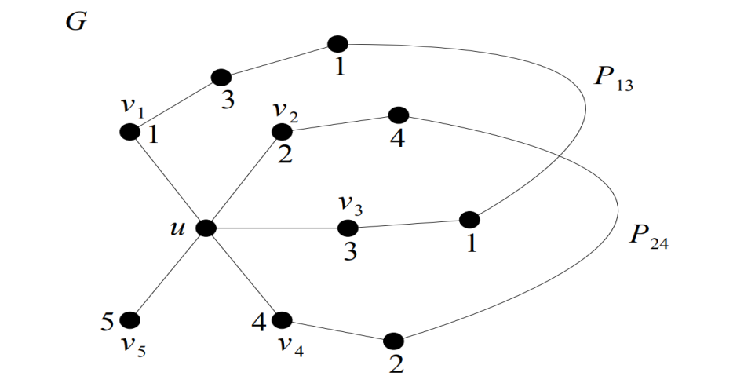

Նկար 13. Ճիշտ գագաթային 5 ներկում

## 2.4 Քառագույն խնդիրը. պատմություն (Կեմպե), Ապպել–Հակենի ապացույց, ժամանակակից ապացույցներ

Գրաֆների տեսության և ընդհանրապես մաթեմատիկայի պատմության մեջ ամենահայտնի ու ազդեցիկ խնդիրներից է Քառագույն խնդիրը (Four Color Problem): Խնդրի էությունը ձևակերպվել է 1852 թվականին Ֆրենսիս Գաթրիի (Francis Guthrie) կողմից, ով նկատեց, որ Անգլիայի կոմսությունների քարտեզը ներկելու համար, այնպես որ սահմանակից կոմսություններն ստանան տարբեր գույներ, բավարար է 4 գույնը: Գաթրին այս հարցն առաջադրեց իր եղբորը՝ Ֆրեդերիկին, ով այն փոխանցեց իր ուսուցիչ Օգաստես դե Մորգանին, իսկ վերջինս էլ խնդրով հետաքրքրեց Արթուր Քեյլիին:

1879 թվականին Ալֆրեդ Կեմպեն (Alfred Kempe) հրապարակեց Քառագույն թեորեմի առաջին «ապացույցը», որը շուրջ 11 տարի ընդունվում էր որպես ճշգրիտ: Կեմպեի ապացույցի հիմքում ընկած էր ինդուկցիոն մեթոդը և հարթ գրաֆում առնվազն մեկ 5-ից չգերազանցող աստիճանով գագաթի գոյությունը: Գագաթի աստիճանը 2, 3 կամ 4 լինելու դեպքերում ինդուկցիոն քայլը դժվարություն չէր ներկայացնում: 5-աստիճանի գագաթի դեպքում Կեմպեն ներմուծեց երկգույն շղթաների վերաձևափոխման հանճարեղ մեթոդը, որն այսօր հայտնի է որպես Կեմպեի շղթաներ (Kempe chains):

Սակայն 1890 թվականին Պերսի Հիվուդը (Percy Heawood) հայտնաբերեց, որ 5-աստիճանի գագաթի դեպքում Կեմպեի առաջարկած երկու զուգահեռ շղթաների միաժամանակյա գույների տեղափոխումը կարող է առաջացնել հակասություն, քանի որ առաջին շղթայի ձևափոխությունը կարող է վերացնել երկրորդ շղթայի անջատվածությունը: Չնայած Կեմպեի ապացույցը թերի էր, նրա ներմուծած Կեմպեի շղթաների մեթոդը հիմնարար նշանակություն ունեցավ գրաֆների ներկման տեսության հետագա զարգացման համար:

Հիվուդի կողմից 5-գույն թեորեմն ապացուցելուց հետո Քառագույն խնդիրը մնում էր չլուծված շուրջ մեկ դար: Խնդրի լուծման համար անհրաժեշտ էր զարգացնել անհաղթահարելի և կրճատելի կոնֆիգուրացիաների տեսությունը, որի հիմքերը դրվեցին Գեորգ Բիրկհոֆի (G. Birkhoff) և Հայնրիխ Հեշի (H. Heesch) աշխատանքներում:

1976 թվականին Քենեթ Ապպելը (Kenneth Appel) և Վոլֆգանգ Հակենը (Wolfgang Haken) Իլինոյսի համալսարանում ավարտեցին Քառագույն թեորեմի պատմական ապացույցը, որն դարձավ մաթեմատիկայի պատմության մեջ առաջին խոշոր թեորեմը՝ ապացուցված համակարգչի էական կիրառմամբ:

**Թեորեմ 2.4.1 (Քառագույն թեորեմ - Կ. Ապպել, Ու. Հակեն, 1976):** Ցանկացած G հարթ գրաֆի քրոմատիկ թիվը չի գերազանցում 4-ը, այսինքն՝

$$\chi(G) \leq 4$$

Ապացույցի գաղափարը: Ապպելի և Հակենի ապացույցը հիմնված է հակասող մինիմալ օրինակի հայեցակարգի վրա: Եթե գոյություն ունենար հարթ գրաֆ, որը 4-ներկելի չէ, ապա դրանցից կարելի էր ընտրել գագաթների փոքրագույն քանակով G հարթ գրաֆը: Օգտագործելով Հեշի կողմից մշակված «լիցքերի բաշխման» մեթոդը՝ Ապպելն ու Հակենը կառուցեցին 1482 անհաղթահարելի կոնֆիգուրացիաներից կազմված ցուցակ: Անհաղթահարելիությունը նշանակում է, որ ցանկացած հարթ գրաֆ պետք է պարունակի այդ ցուցակի առնվազն մեկ կոնֆիգուրացիա: Հատուկ մշակված համակարգչային ծրագրերի միջոցով (որոնք աշխատեցին ավելի քան 1200 ժամ) ապացուցվեց, որ ցուցակի բոլոր 1482 կոնֆիգուրացիաներն էլ կրճատելի են, այսինքն՝ դրանցից ոչ մեկը չի կարող պատկանել մինիմալ հակասող օրինակին: Ստացված հակասությունն ապացուցում է Քառագույն թեորեմը:

Ապպել–Հակենի ապացույցը սկզբնապես արժանացավ որոշակի մաթեմատիկոսների վերապահմանը, քանի որ 1482 կոնֆիգուրացիաների կրճատելիության համակարգչային ստուգումը մարդու ուժերից վեր էր և հնարավոր չէր ավանդական եղանակով վերստուգել ձեռքով:

1997 թվականին Նիլ Ռոբերտսոնը (Neil Robertson), Դանիել Զանդերսը (Daniel P. Sanders), Փոլ Սեյմուրը (Paul Seymour) և Ռոբին Թոմասը (Robin Thomas) մշակեցին Քառագույն թեորեմի նոր, զգալիորեն պարզեցված ապացույց: Նրանք կրճատեցին անհաղթահարելի կոնֆիգուրացիաների քանակը հասցնելով 633-ի, իսկ լիցքերի բաշխման կանոնների քանակը՝ 31-ի: Այս նոր ապացույցում համակարգչային ծրագրերի աշխատանքի ժամանակը կրճատվեց ընդամենը մի քանի րոպեի, իսկ լիցքավորման մեթոդի տեսական մասը դարձավ լիովին վերստուգելի ձեռքով:

Վերջապես, 2005 թվականին Ժորժ Գոնտիեն (Georges Gonthier) և Բենջամին Վերներ (Benjamin Werner) իրականացրեցին Քառագույն թեորեմի Ռոբերտսոն-Զանդերս-Սեյմուր-Թոմաս ապացույցի ամբողջական ֆորմալ վերիֆիկացիան Coq ապացույցների ավտոմատ ստուգման համակարգի (interactive theorem prover) միջոցով: Սրանով վերացվեց համակարգչային ծրագրերում հնարավոր ալգորիթմական սխալների վերաբերյալ վերջին կասկածը, և Քառագույն թեորեմը դարձավ մաթեմատիկորեն լիովին հաստատված պնդում:

## 2.5 Ներկման ալգորիթմներ և բարդություն. Greedy, Welsh–Powell, DSATUR, հետադարձման (backtracking) մեթոդ, խնդրի NP-լրիվությունը

Գրաֆների գագաթային ներկման խնդրի ալգորիթմական վերլուծությունը հանդիսանում է համակարգչային գիտության և դիսկրետ օպտիմալացման կենտրոնական հարցերից մեկը: Թեև խնդրի ձևակերպումն չափազանց պարզ է, նրա արդյունավետ լուծումը կամայական գրաֆների համար բախվում է սկզբունքային ալգորիթմական դժվարությունների:

**Սահմանում 2.5.1:** Գրաֆների ներկման որոշման խնդիրը ձևակերպվում է հետևյալ կերպ. տրված է $G = (V,\ E)$ գրաֆը և $k \in {\mathbb{N}}$ ամբողջ թիվը. պահանջվում է պարզել, թե արդյոք գոյություն ունի G գրաֆի գագաթային ճիշտ k-ներկում, այսինքն՝ արդյոք $\chi(G) \leq k$:

Համակարգչային բարդության տեսության համաձայն, այս որոշման խնդիրը պատկանում է NP դասին, քանի որ ցանկացած առաջարկված ներկման թեկնածուի ճշտությունը կարելի է ստուգել պոլինոմիալ ժամանակում՝ ստուգելով բոլոր m կողերի ծայրակետերի գույների տարբերությունը $Ο(n + m)$ ժամանակում: Սակայն, ինչպես ապացուցեց Ս. Կուկը (S. Cook, 1971) և Ռ. Կարպը (R. Karp, 1972), գրաֆի ճիշտ 3-ներկման առկայության որոշման խնդիրը հանդիսանում է NP-լրիվ խնդիր:

**Թեորեմ 2.5.1 (Ռ. Կարպ, 1972):** Կամայական $k \geq 3$ բնական թվի համար գրաֆի k-ներկելիության որոշման խնդիրը NP-լրիվ է:

Ապացույցի գաղափարը: Թեորեմի ապացույցը հիմնվում է 3-SAT (3-Satisfiability) բուլյան բանաձևերի իրագործելիության NP-լրիվ խնդրից դեպի 3-ներկման խնդիր պոլինոմիալ բերման վրա: 3-SAT բանաձևի յուրաքանչյուր փոփոխականի և դիզյունկտի համար կառուցվում է հատուկ օժանդակ ենթագրաֆ (գաջեթ) :Օժանդակ ենթագրաֆի գագաթների 3-ներկումը հնարավոր է դառնում այն և միայն այն դեպքում, երբ համապատասխան բուլյան դիզյունկտը ճշմարիտ է: Քանի որ 3-SAT խնդիրը NP-լրիվ է, ապա նրանից պոլինոմիալ ժամանակում բերվող 3-ներկման խնդիրը նույնպես NP-լրիվ է:

Այստեղից անմիջապես հետևում է, որ գրաֆի քրոմատիկ թվի ճշգրիտ որոնման օպտիմալացման խնդիրը հանդիսանում է NP-բարդ: Հետևաբար, եթե $P \neq NP$, ապա գոյություն չունի պոլինոմիալ ալգորիթմ, որը ունակ է ճշգրիտ հաշվել կամայական գրաֆի քրոմատիկ թիվը: Այս պատճառով գործնականում կիրառվում են ճշգրիտ հետադարձման (backtracking) ալգորիթմներ փոքր չափի գրաֆների համար և մոտավոր կամ մոտարկային (heuristics) ալգորիթմներ մեծ չափի գրաֆների համար:

Գրաֆների ներկման ամենապարզ և արագագործ մոտարկային մեթոդը Ագահ (Greedy) ալգորիթմն է, որը գագաթները ներկում է հաջորդաբար՝ ըստ նախապես տրված համարակալման:

**Սահմանում 2.5.2:** Դիցուք տրված է $G = (V,\ E)$ գրաֆը և նրա գագաթների $\pi = (v_{1},\ v_{2},\ .\ .\ .\ ,\ v_{n})$ որոշակի կարգավորվածությունը: Ագահ ալգորիթմը քայլ առ քայլ, $i = 1\ ,2,\ .\ .\ .\ ,n$ ինդեքսների աճման կարգով, $v_{1}$ գագաթին վերագրում է այն ամենափոքր ինդեքսով $c(v_{i}) \in \{ 1,2,...\}$ գույնը, որը դեռևս վերագրված չէ $v_{i}$ գագաթի արդեն ներկված հարևաններից և ոչ մեկին:

Ագահ ալգորիթմի աշխատանքի ժամանակային բարդությունը կազմում է $Ο(n + m)$ կամ վատթարագույն դեպքում $Ο(n^{2})$, քանի որ յուրաքանչյուր գագաթի համար ստուգվում են միայն նրա հարևանների գույները: Սակայն Ագահ ալգորիթմով ստացված գույների քանակը էապես կախված է գագաթների $\pi$ համարակալման կարգից: Սխալ ընտրված համարակալման դեպքում ալգորիթմը կարող է օգտագործել անհամեմատ ավելի շատ գույներ, քան իրական քրոմատիկ թիվն է (օրինակ, n գագաթանի երկկողմանի գրաֆի համար, որի $\chi(G) = 2$, Ագահ ալգորիթմը վատթարագույն համարակալման դեպքում կարող է ծախսել $n/2$ գույն):

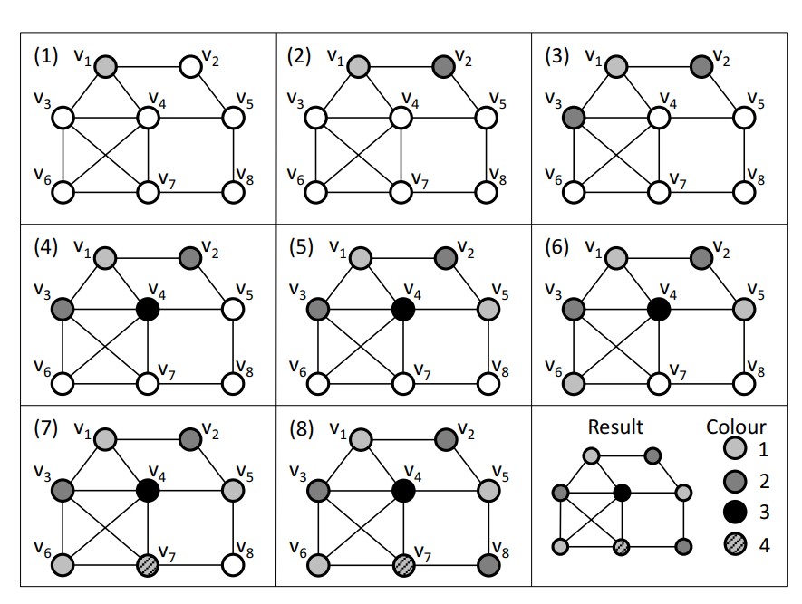

Նկար 14. \<\<Ագահ\>\> (GREEDY) ալգորիթմի կիրառման օրինակ՝ օգտագործելով $\pi_{i} = v_{i\ }(1 \leq i \leq n)$ տեղափոխությունը։ Այստեղ չգունավորված գագաթները պատկերված են սպիտակ գույնով։

Ագահ ալգորիթմի արդյունավետությունը բարձրացնելու նպատակով Դ. Վելշը և Մ. Փաուելը (D. Welsh, M. Powell, 1967) առաջարկեցին գագաթները նախապես կարգավորել ըստ դրանց աստիճանների նվազման:

**Սահմանում 2.5.3:** Վելշ–Փաուելի ալգորիթմում G գրաֆի գագաթները նախ վերադասավորվում են ըստ աստիճանների չաճման կարգի.

$$d(v_{1}) \geq d(v_{2}) \geq .\ .\ .\  \geq d(v_{n})$$

Այնուհետև կիրառվում է Ագահ ներկման ընթացակարգը: Սկզբում առաջին գույնով ներկվում է $v_{1}$ գագաթը, ապա ցուցակով առաջ շարժվելով՝ նույն առաջին գույնով ներկվում են բոլոր այն գագաթները, որոնք հարևան չեն արդեն 1-ին գույնն ստացած գագաթներին: Այնուհետև ընտրվում է հաջորդ չներկված գագաթը, նրան վերագրվում է 2-րդ գույնը, և գործընթացը կրկնվում է նոր գույնի համար այնքան ժամանակ, քանի դեռ բոլոր գագաթները ներկված չեն:

Վելշ–Փաուելի ալգորիթմն ապահովում է, որ մեծ աստիճան (շատ հարևաններ) ունեցող գագաթները ներկվեն առաջին հերթին, ինչը էապես նվազեցնում է օգտագործվող գույների ընդհանուր քանակը: Ալգորիթմի բարդությունը կազմում է $Ο(n\log n + m)$, որտեղ $n\log n$-ը պահանջվում է գագաթների տեսակավորման համար:

Ի տարբերություն Ագահ և Վելշ–Փաուելի ալգորիթմների, որտեղ գագաթների ներկման հաջորդականությունը ֆիքսվում է նախքան ներկումը սկսելը, Դ. Բրելազի (D. Brélaz, 1979) առաջարկած DSATUR (Degree of Saturation) ալգորիթմում հաջորդ ներկվող գագաթն ընտրվում է դինամիկ կերպով՝ ներկման ընթացքում:

**Սահմանում 2.5.4:** Դիցուք G գրաֆի գագաթների մի մասն արդեն ներկված է: Չներկված $v \in V(G)$ գագաթի հագեցման աստիճան (saturation degree), որը նշանակվում է sat(v) սիմվոլով, կոչվում է v գագաթին հարևան արդեն ներկված գագաթների տարբեր գույների քանակը:

**DSATUR ալգորիթմի քայլերը.**

1.  Սկզբնական փուլում բոլոր գագաթների հագեցման աստիճանները հավասար են 0-ի ($sat(v) = 0$): Առաջինը ներկման համար ընտրվում է առավելագույն d(v) աստիճան ունեցող գագաթը և ներկվում 1-ին գույնով:

2.  Ամեն հաջորդ քայլում չներկված գագաթներից ընտրվում է այն v գագաթը, որն ունի առավելագույն sat(v) հագեցման աստիճան:

3.  Եթե առավելագույն հագեցման աստիճան ունեցող գագաթները մի քանիսն են, ապա հավասարությունը լուծվում է հօգուտ այն գագաթի, որն ունի առավելագույն d(v) աստիճան սկզբնական գրաֆում (իսկ եթե դրանք էլ են հավասար՝ ընտրվում է կամայականորեն):

4.  Ընտրված v գագաթին վերագրվում է նրա հարևանների կողմից չօգտագործված առաջին հասանելի ամենափոքր ինդեքսով գույնը:

5.  Վերահաշվարկվում են v-ի չներկված հարևանների հագեցման sat(u) աստիճանները: Գործընթացը կրկնվում է, քանի դեռ բոլոր գագաթները ներկված չեն:

**Թեորեմ 2.5.2 (Դ. Բրելազ, 1979):** DSATUR ալգորիթմը կառուցում է ճշգրիտ օպտիմալ ներկում (օգտագործելով ճիշտ $\chi(G)$ քանակով գույներ) երկկողմանի գրաֆների, պարզ ցիկլերի ($C_{k}$) և անիվաձև գրաֆների (wheel graphs, $W_{n}$) համար:

DSATUR ալգորիթմի վատթարագույն ժամանակային բարդությունը կազմում է $Ο(n^{2})$, սակայն գործնականում այն ցուցաբերում է բարձր արդյունավետություն և օգտագործում է զգալիորեն ավելի քիչ գույներ, քան ստատիկ Ագահ ալգորիթմները:

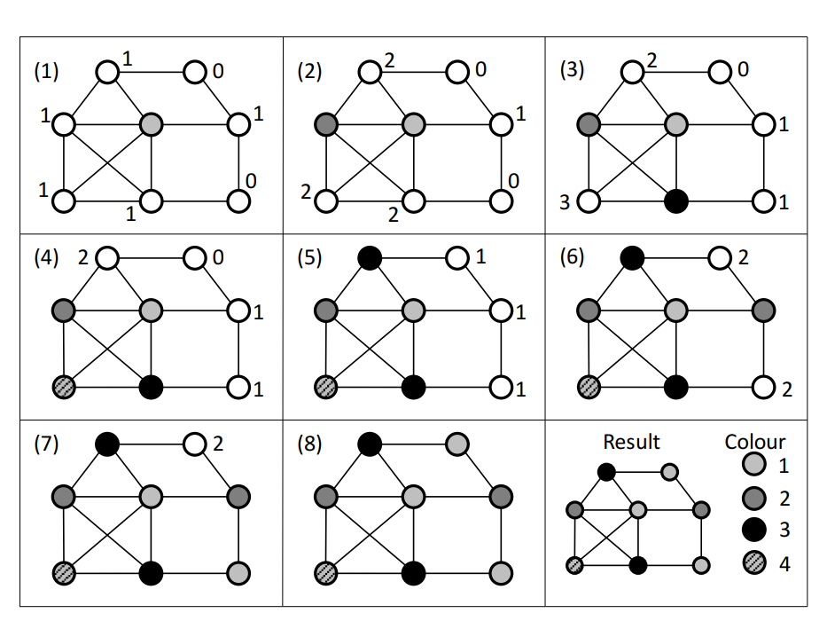

Նկար 15. DSATUR ալգորիթմի կիրառման օրինակ։ Այստեղ չգունավորված գագաթները (X-ի անդամները) պատկերված են սպիտակ գույնով, և դրանց կողքին նշված են դրանց հագեցվածության աստիճանները։

Գրաֆի քրոմատիկ թվի ճշգրիտ հաշվման և օպտիմալ ներկման կառուցման համար օգտագործվում է հետադարձման (backtracking) մեթոդը, որն իրականացնում է որոնման ծառի համակարգված խորացված շրջանցում (Depth-First Search - DFS):

**Հետադարձման ալգորիթմի մեխանիզմը.**

1.  Գրաֆի գագաթները համարակալվում են $v_{1},\ v_{2},\ .\ .\ .\ ,\ v_{n}$ կարգով (օրինակ՝ DSATUR-ի կամ Welsh–Powell-ի մոտարկային ալգորիթմով):

2.  Սկզբնական փուլում հասանելի գույների առավելագույն թիվը սահմանվում է $k = n\ $(կամ որևէ մոտարկային ալգորիթմով ստացված վերին գնահատական):

3.  Ալգորիթմը հաջորդաբար փորձում է ներկել $v_{1},\ v_{2},\ .\ .\ .\ $ գագաթները հասանելի $\{ 1,\ 2,\ .\ .\ .\ ,\ k - 1\}$ գույներով:

4.  Եթե $v_{i}$ գագաթի համար չկա ոչ մի թույլատրելի գույն առաջին $k - 1$ գույների շարքում (քանի որ նրա բոլոր հարևաններն արդեն օգտագործել են այդ գույները), ապա տվյալ ճյուղի հետագա խորացումը դադարեցվում է, և ալգորիթմը կատարում է հետադարձ քայլ (backtrack) դեպի $v_{i - 1}$ գագաթը՝ փորձելով նրան վերագրել հաջորդ հասանելի գույնը:

5.  Եթե հաջողվում է ներկել բոլոր n գագաթները $k - 1$ կամ ավելի քիչ գույներով, ապա գրանցվում է նոր լավագույն լուծում, k-ի արժեքը նվազեցվում է, և որոնումը շարունակվում է ավելի փոքր թվով գույների համար:

Հետադարձման մեթոդն երաշխավորում է ճշգրիտ օպտիմալ լուծման գտնումը, սակայն վատթարագույն դեպքում նրա ժամանակային բարդությունն էքսպոնենցիալ է՝ $Ο(k^{n})$: Հետևաբար, գործնականում հետադարձման ալգորիթմները կիրառելի են համեմատաբար փոքր (մինչև 100-200 գագաթ ունեցող) գրաֆների համար:

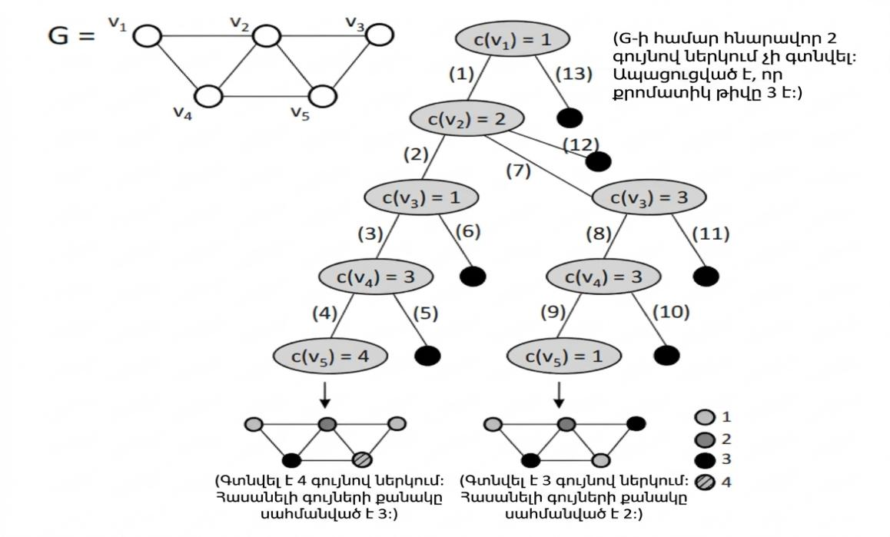

Նկար 16. Հետադարձման (backtracking) ալգորիթմի օրինակ
